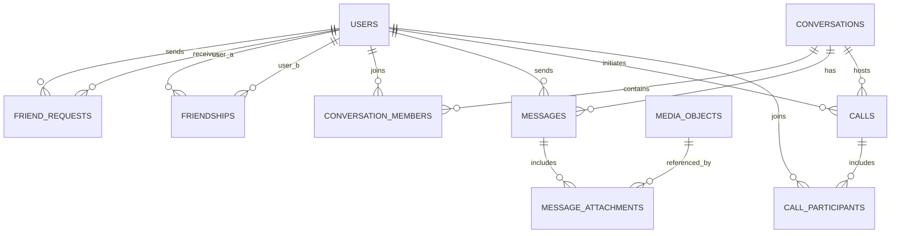

# Chatter database design

> API reference: see [docs/API.md](docs/API.md) for current REST, WebSocket, and internal gRPC endpoints and implementation status.

Chatter is a messaging app focused on direct and group chat, adding friends, and video calls. This design uses PostgreSQL for durable application data. Video and audio travel over a real-time media service (for example, WebRTC); the database stores call coordination and history, not media streams.

## Design overview

- A user can have many friends and belong to many conversations.
- A conversation can be a direct chat or a group chat. Direct chats have exactly two active members; a unique canonical pair prevents duplicate direct conversations.
- Friend relationships are mutual and stored once. Requests are directional and have a clear pending/accepted/rejected/cancelled state.
- Messages belong to a conversation and have a sender. Message attachments reference uploaded media metadata; the files themselves live in object storage.
- A call belongs to a conversation and records its initiator, status, timing, and participants. Signaling is exchanged through a real-time service and is not retained as chat content.

## Entity relationships



## PostgreSQL schema

The following is a starting point. Use UUIDs generated by the application or `gen_random_uuid()` (requires `pgcrypto` on older PostgreSQL versions).

```sql
CREATE EXTENSION IF NOT EXISTS pgcrypto;

CREATE TABLE users (
    id                  uuid PRIMARY KEY DEFAULT gen_random_uuid(),
    username            text NOT NULL UNIQUE,
    display_name        text NOT NULL,
    email               text UNIQUE,
    password_hash       text NOT NULL,
    avatar_media_id     uuid,
    status_message      text,
    presence            text NOT NULL DEFAULT 'offline'
                        CHECK (presence IN ('online', 'away', 'offline', 'do_not_disturb')),
    last_seen_at        timestamptz,
    created_at          timestamptz NOT NULL DEFAULT now(),
    updated_at          timestamptz NOT NULL DEFAULT now(),
    deleted_at          timestamptz
);

CREATE TABLE friend_requests (
    id                  uuid PRIMARY KEY DEFAULT gen_random_uuid(),
    sender_id           uuid NOT NULL REFERENCES users(id),
    recipient_id        uuid NOT NULL REFERENCES users(id),
    status              text NOT NULL DEFAULT 'pending'
                        CHECK (status IN ('pending', 'accepted', 'rejected', 'cancelled')),
    created_at          timestamptz NOT NULL DEFAULT now(),
    responded_at        timestamptz,
    CHECK (sender_id <> recipient_id)
);
-- Only one unresolved request per direction. Opposite-direction requests can
-- both exist; the service should accept one and resolve the other atomically.
CREATE UNIQUE INDEX friend_requests_one_pending_direction
    ON friend_requests (sender_id, recipient_id) WHERE status = 'pending';
CREATE INDEX friend_requests_inbox ON friend_requests (recipient_id, created_at DESC)
    WHERE status = 'pending';

CREATE TABLE friendships (
    user_a_id           uuid NOT NULL REFERENCES users(id),
    user_b_id           uuid NOT NULL REFERENCES users(id),
    created_at          timestamptz NOT NULL DEFAULT now(),
    created_from_request_id uuid REFERENCES friend_requests(id),
    PRIMARY KEY (user_a_id, user_b_id),
    CHECK (user_a_id < user_b_id)
);
CREATE INDEX friendships_by_b ON friendships (user_b_id, user_a_id);

CREATE TABLE conversations (
    id                  uuid PRIMARY KEY DEFAULT gen_random_uuid(),
    type                text NOT NULL CHECK (type IN ('direct', 'group')),
    title               text,
    created_by          uuid NOT NULL REFERENCES users(id),
    -- Set for direct chats to the sorted pair of member IDs. NULL for groups.
    direct_user_low     uuid REFERENCES users(id),
    direct_user_high    uuid REFERENCES users(id),
    created_at          timestamptz NOT NULL DEFAULT now(),
    updated_at          timestamptz NOT NULL DEFAULT now(),
    last_message_at     timestamptz,
    CHECK (
        (type = 'direct' AND direct_user_low IS NOT NULL AND direct_user_high IS NOT NULL
         AND direct_user_low < direct_user_high AND title IS NULL)
        OR (type = 'group' AND direct_user_low IS NULL AND direct_user_high IS NULL)
    )
);
CREATE UNIQUE INDEX conversations_unique_direct_pair
    ON conversations (direct_user_low, direct_user_high) WHERE type = 'direct';

CREATE TABLE conversation_members (
    conversation_id     uuid NOT NULL REFERENCES conversations(id),
    user_id             uuid NOT NULL REFERENCES users(id),
    role                text NOT NULL DEFAULT 'member'
                        CHECK (role IN ('owner', 'admin', 'member')),
    joined_at           timestamptz NOT NULL DEFAULT now(),
    left_at             timestamptz,
    last_read_message_id uuid,
    muted_until         timestamptz,
    PRIMARY KEY (conversation_id, user_id)
);
CREATE INDEX conversation_members_user_active
    ON conversation_members (user_id, conversation_id) WHERE left_at IS NULL;

CREATE TABLE messages (
    id                  uuid PRIMARY KEY DEFAULT gen_random_uuid(),
    conversation_id     uuid NOT NULL REFERENCES conversations(id),
    sender_id           uuid NOT NULL REFERENCES users(id),
    client_message_id   text,
    body                text,
    kind                text NOT NULL DEFAULT 'text'
                        CHECK (kind IN ('text', 'image', 'video', 'file', 'system')),
    reply_to_message_id uuid REFERENCES messages(id),
    created_at          timestamptz NOT NULL DEFAULT now(),
    edited_at           timestamptz,
    deleted_at          timestamptz,
    CHECK (body IS NOT NULL OR kind <> 'text')
);
-- Idempotency key scoped to sender and conversation; partial so legacy rows can
-- omit it. Message access must be checked against conversation_members.
CREATE UNIQUE INDEX messages_client_idempotency
    ON messages (conversation_id, sender_id, client_message_id)
    WHERE client_message_id IS NOT NULL;
CREATE INDEX messages_conversation_timeline
    ON messages (conversation_id, created_at DESC, id DESC);

CREATE TABLE media_objects (
    id                  uuid PRIMARY KEY DEFAULT gen_random_uuid(),
    owner_id            uuid NOT NULL REFERENCES users(id),
    storage_key         text NOT NULL UNIQUE,
    media_type          text NOT NULL,
    byte_size           bigint NOT NULL CHECK (byte_size >= 0),
    duration_ms         bigint CHECK (duration_ms IS NULL OR duration_ms >= 0),
    created_at          timestamptz NOT NULL DEFAULT now(),
    deleted_at          timestamptz
);

CREATE TABLE message_attachments (
    message_id          uuid NOT NULL REFERENCES messages(id) ON DELETE CASCADE,
    media_object_id     uuid NOT NULL REFERENCES media_objects(id),
    position            smallint NOT NULL DEFAULT 0 CHECK (position >= 0),
    PRIMARY KEY (message_id, position),
    UNIQUE (message_id, media_object_id)
);

ALTER TABLE users ADD CONSTRAINT users_avatar_media_fk
    FOREIGN KEY (avatar_media_id) REFERENCES media_objects(id);

CREATE TABLE calls (
    id                  uuid PRIMARY KEY DEFAULT gen_random_uuid(),
    conversation_id     uuid NOT NULL REFERENCES conversations(id),
    initiated_by        uuid NOT NULL REFERENCES users(id),
    mode                text NOT NULL CHECK (mode IN ('audio', 'video')),
    status              text NOT NULL DEFAULT 'ringing'
                        CHECK (status IN ('ringing', 'active', 'ended', 'missed', 'declined', 'failed')),
    started_at          timestamptz,
    ended_at            timestamptz,
    created_at          timestamptz NOT NULL DEFAULT now(),
    CHECK (ended_at IS NULL OR started_at IS NULL OR ended_at >= started_at)
);
CREATE INDEX calls_conversation_history
    ON calls (conversation_id, created_at DESC);

CREATE TABLE call_participants (
    call_id             uuid NOT NULL REFERENCES calls(id) ON DELETE CASCADE,
    user_id             uuid NOT NULL REFERENCES users(id),
    status              text NOT NULL DEFAULT 'invited'
                        CHECK (status IN ('invited', 'joined', 'declined', 'left', 'missed')),
    invited_at          timestamptz NOT NULL DEFAULT now(),
    joined_at           timestamptz,
    left_at             timestamptz,
    PRIMARY KEY (call_id, user_id)
);
```

## Rules enforced by the application

Some rules span rows and are best enforced in transactions or database triggers:

1. **Friend acceptance:** lock the pending request, change it to `accepted`, insert one `friendships` row with IDs sorted (`least(sender_id, recipient_id)`, `greatest(...)`), and resolve any reverse pending request in one transaction. `ON CONFLICT DO NOTHING` makes acceptance safe to retry.
2. **Direct chat creation:** sort the two user IDs and insert the conversation and its two membership rows in one transaction. If the unique pair already exists, return that conversation. Require an accepted friendship if product rules say only friends can chat.
3. **Message authorization:** verify sender is an active member before inserting. On a group removal, set `left_at`; retain membership history so old messages remain attributable. Do not allow a message reply to cross conversations.
4. **Read receipts:** update a member's `last_read_message_id` only to a message in the same conversation, and never move it backward. This stores one compact read cursor per member rather than a row for every message view.
5. **Calls:** require the caller to be an active conversation member. Update call and participant states transactionally; the real-time service handles ringing, SDP/ICE exchange, and media routing. Apply short expiry to temporary signaling data held outside this schema.

## Operational notes

- Use cursor pagination ordered by `(created_at, id)` for message history; avoid large offset scans. At higher volume, partition `messages` by time or conversation after measuring query and retention needs.
- Keep presence and typing indicators in Redis or another short-lived store. Persisting every heartbeat would create unnecessary write volume.
- Store password hashes using a modern password hashing algorithm. Never store plaintext passwords, access tokens, or raw call signaling secrets in these tables.
- Use soft deletion or retention jobs according to product policy. Define whether account deletion anonymizes sender references or removes data, and handle backups consistently.
- Consider a `message_receipts` table only if the product needs per-user delivered/read status for each message; for simple chat, `last_read_message_id` is smaller and sufficient for unread counts.
- Add authorization checks to every query, and use encryption in transit and at rest. Indexes above are starting points; validate them against real query patterns.

## Main query patterns

- **Conversation list:** active `conversation_members` for a user, joined to conversations, ordered by `last_message_at DESC`.
- **Messages:** fetch a page for one conversation using a cursor on `(created_at, id)`; join sender and attachments.
- **Friend list:** query `friendships` where the user's ID is either endpoint, then load the opposite user's profile.
- **Incoming requests:** query pending `friend_requests` by recipient and sort newest first.
- **Call history:** query calls by conversation, newest first, with participants.


## API Gateway and realtime delivery

The Gin API Gateway owns client HTTP/WebSocket connections. It does not open a PostgreSQL connection. Registration and profile operations go to UserService; login and refresh go to AuthService; message persistence and unread/delivery operations go to ChatService over gRPC. Configure their gRPC targets under services in config/config.yaml.

### Gateway endpoints

| Method | Path | Authentication | Upstream |
| --- | --- | --- | --- |
| POST | /api/v1/auth/register | Public | UserService.Register, then AuthService.Login |
| POST | /api/v1/auth/login | Public | AuthService.Login, then UserService.GetUserByID |
| POST | /api/v1/auth/refresh | Refresh token | AuthService.Refresh |
| GET | /api/v1/profile | JWT + Casbin | UserService.GetUserByID for the JWT subject |
| PATCH | /api/v1/profile | JWT + Casbin | UserService.UpdateUser |
| GET | /api/v1/chat/conversations | JWT + Casbin | ChatService.ListConversations |
| POST | /api/v1/chat/conversations | JWT + Casbin | ChatService.GetOrCreateDirectConversation (requires accepted friendship) |
| GET | /api/v1/chat/conversations/:id/messages?limit=50 | JWT + Casbin | ChatService.ListMessages (active membership required) |
| POST | /api/v1/chat/messages/:id/delivered | JWT + Casbin | ChatService.MarkDelivered for current user |
| GET | /api/v1/chat/unread?limit=50 | JWT + Casbin | ChatService.ListUnreadMessages, then MarkDelivered for each message |
| GET | /api/v1/ws/presence?token=<access-token> | JWT + Casbin | WebSocket connection to this gateway |

WebSocket clients send JSON frames such as {"type":"send_message","conversation_id":"...","body":"hello"}. The gateway takes the sender ID from the validated JWT and calls ChatService.SendMessage; it does not trust a sender ID supplied by the client. The chat service must validate conversation membership, persist the message, and only then publish delivery events to Redis.

### Redis and offline flow

Each gateway instance keeps a local userID -> WebSocket connections pool. For each user connected to that instance, the gateway subscribes to Redis channel chat:user:<userID> and forwards each event payload to that user's local sockets. The Chat Service publishes to the recipient user's channel after committing the message. Redis Pub/Sub provides live fan-out across gateway instances; it is ephemeral and is not the source of truth.

The unread endpoint reads pending messages from Postgres and marks each result delivered. The frontend drains this inbox after each WebSocket connection/reconnection. When Redis has no active presence key for a recipient, Chat Service also publishes a persistent JSON notification to the RabbitMQ `notification` queue for a future push/email worker; delivery recovery remains independent of that notification.

proto/auth.proto, proto/user.proto, and proto/chat.proto define the RPC surface used by the gateway. The Auth Service must sign access JWTs with the same configured verification key/algorithm expected by the gateway, and assign a role claim. Protect internal gRPC links with TLS in deployed environments; the current local client setup uses insecure transport credentials for development. Casbin enforces route/method access in the gateway. The Chat Service must enforce conversation-level authorization for each send/read/delivery RPC because route-level Casbin cannot decide membership in a specific conversation.


## Generating Go gRPC code

Generated protobuf messages and gRPC clients/servers are checked in under proto/. The gateway uses these typed clients from grpc_clients.go. To regenerate after editing a schema, install protoc and the pinned Go plugins, then run go generate ./proto from the backend root:

- go install google.golang.org/protobuf/cmd/protoc-gen-go@v1.36.10
- go install google.golang.org/grpc/cmd/protoc-gen-go-grpc@v1.6.2
- go generate ./proto

The protoc binary and the Go bin directory must both be available on PATH. buf.gen.yaml is also included for teams that use Buf.

## Local image storage

Copy `.env.example` to `.env`, set a local MinIO password, then start the
Compose stack with `docker compose up -d`. The API Gateway creates the
configured private bucket on first upload. Images are restricted to valid
JPEG, PNG, or GIF files up to 10 MB and are served through the authenticated
Gateway; the MinIO bucket is not public.
